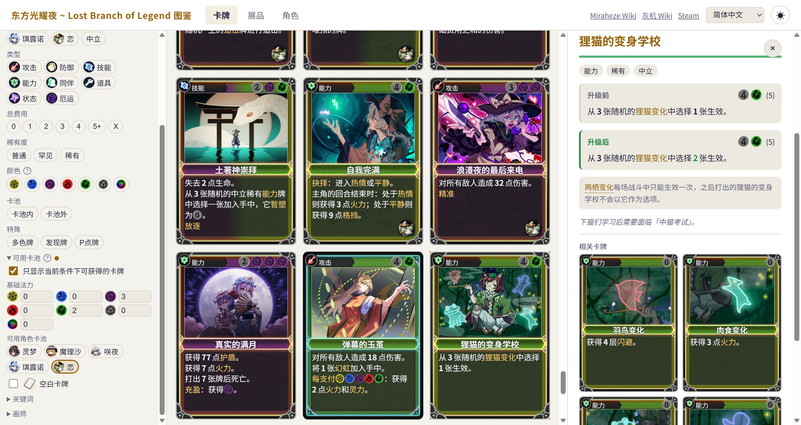
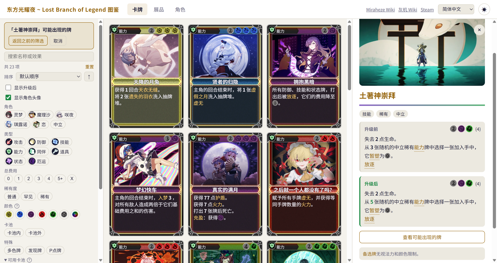

# Touhou: Lost Branch of Legend Codex

[**lbol.mojimoon.top**](https://lbol.mojimoon.top) is a web-based companion app for the game [Touhou: Lost Branch of Legend](https://store.steampowered.com/app/1140150/Touhou_Lost_Branch_of_Legend/), a fan-made rougelike deckbuilder game based on the Touhou Project series.

**Please give a star if you find this project useful!** ⭐

[**lbol.mojimoon.top**](https://lbol.mojimoon.top) 是 [东方光耀夜 \~Lost Branch of Legend\~](https://store.steampowered.com/app/1140150/Touhou_Lost_Branch_of_Legend/) 的网页图鉴，游戏由 Alioth Studio 开发，是一款东方 Project 同人 rougelike 卡牌游戏。

**如果你觉得这个项目有用，请点个星标支持一下！** ⭐

## Screenshots

## Features

- View all cards, exhibits, and characters in the game, including their stats, effects, and flavor text.
- Search and filter with various criteria, such as card type, rarity, and character.
- Explore advanced options not available in the game, such as filtering by available card pools with the current character, or viewing all possible outcomes of discovered cards.
- Supports all 16 languages in the game, with a responsive design and dark mode.

---

- 查看游戏中所有卡牌、展品和角色，包括它们的属性、效果和背景故事。
- 使用各种条件进行搜索和筛选，例如卡牌类型、稀有度和角色。
- 可以探索游戏中没有的高级选项，例如按当前角色可用的牌池进行筛选，或查看发现牌的所有可能产物。
- 支持游戏中所有 16 种语言，采用响应式设计，提供深色模式。

## Disclaimer

This project is not affiliated with or endorsed by Alioth Studio. All content related to Touhou: Lost Branch of Legend is the property of their respective owners. This project is intended for educational and informational purposes only.
